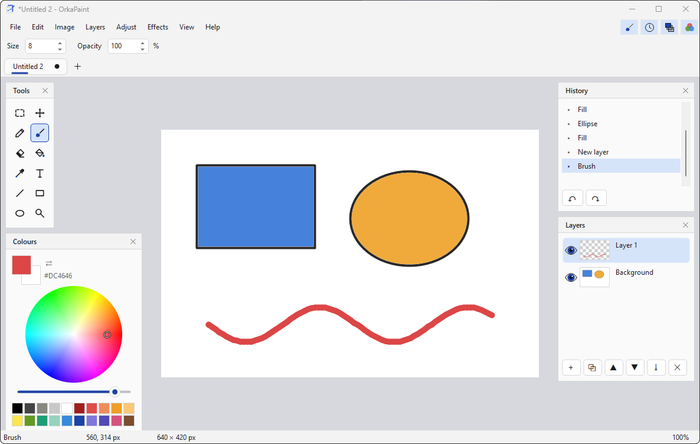
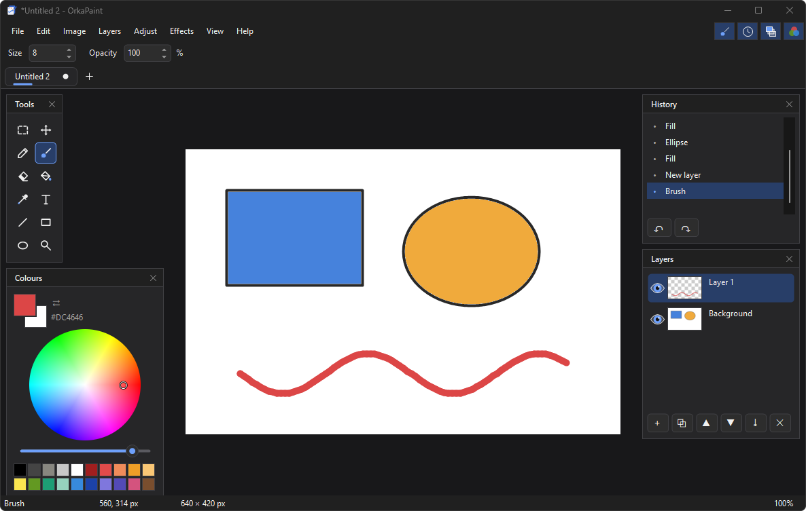
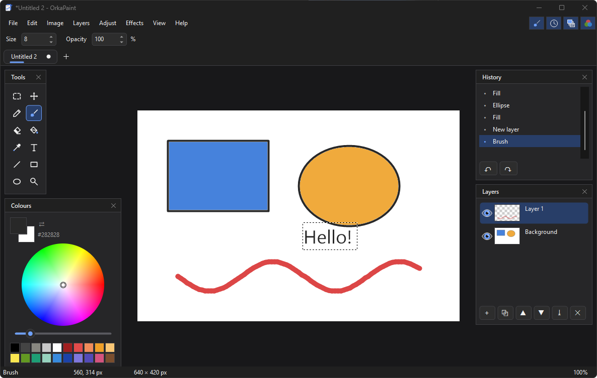
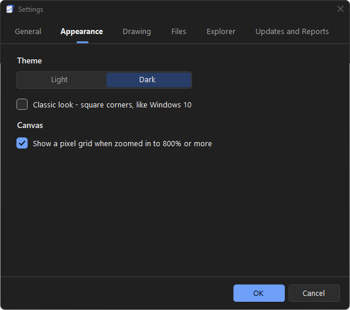
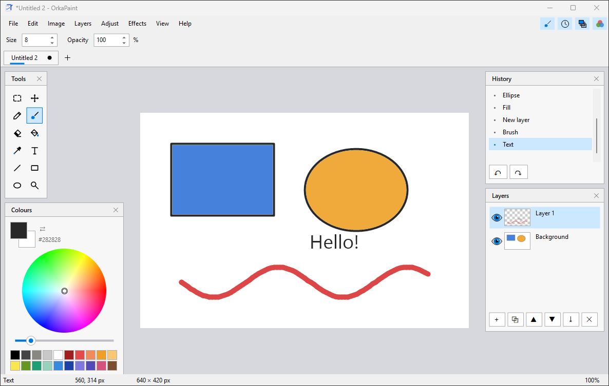

# OrkaPaint

A drawing program for Windows - a bit more than plain Paint: layers, selections, colour adjustments and effects, in a light or dark window. No ads, nothing to sign up for, and it does not go online unless you let it.



**[Download the latest version](https://github.com/cyz-yt/OrkaPaint/releases/latest)** · [Website](https://cyzs-retroweb.rf.gd/orkapaint.php)

Current version: **1.0.1 "Azurite"**

## What it does

**Drawing**
- Pencil, brush, eraser, bucket fill, colour picker, line, rectangle, ellipse and text you type straight onto the picture.
- Select an area, move it, cut, copy, crop to it, or fill and clear it. Like in Paint, moving a piece of the background leaves the second colour behind; on other layers it leaves transparency.
- Size and opacity for every tool, and a colour wheel with your own swatches.

**Layers**
- Add, duplicate, hide, reorder, merge down and flatten. Each layer has its own opacity.
- Paste as a new layer. Save as `.ora` (OpenRaster) to keep the layers - GIMP and Krita open it too.

**Picture**
- Resize, canvas size, crop, rotate and flip.
- Adjustments: brightness and contrast, hue and saturation, black and white, invert colours.
- Effects with a live preview: blur, sharpen, pixelate.

**Around it**
- Several pictures at once, in tabs.
- History: click any step to go back to it.
- Floating panels (Tools, Colours, History, Layers) you can move, hide and bring back with F5-F8.
- Light or dark (the same as Windows at first), plus a classic look with square corners like Windows 10.
- Windows in 8 languages: English, Polish, German, Spanish, French, Italian, Portuguese and Ukrainian - Windows language by default. Yours is missing? Settings > Language editor.
- "Open in OrkaPaint" in the Explorer menu for pictures (an option in Settings).
- A short tutorial on the first run and a tip on every run after.
- Portable mode: put an empty `portable.txt` next to `OrkaPaint.exe` and the settings and log stay next to it.

Opens PNG, JPG, BMP, GIF, TIFF, ICO and `.ora`. Saves PNG, JPG, BMP and `.ora`.

## Screenshots

| | |
|---|---|
|  |  |
| The dark theme | Typing text straight onto the picture |
|  |  |
| Settings with tabs at the top | The classic look (1.0.1) |

## Installing

1. Download `OrkaPaint-1.0.1-setup.exe` from [Releases](https://github.com/cyz-yt/OrkaPaint/releases/latest).
2. Run it. Windows may show "Windows protected your PC", because the installer is not code-signed. Click **More info**, then **Run anyway**.
3. **Express** installs everything. **Custom** lets you leave out window languages.

**Requirements:** Windows 10 or 11 and .NET Framework 4.7.2 - Windows 10 and 11 already have it.

**Quiet install** (for scripts):

```
OrkaPaint-1.0.1-setup.exe /SILENT /CURRENTUSER /openwith=yes /contextmenu=no /updates=yes /theme=system
```

`/openwith=no` leaves file associations alone, `/contextmenu=yes` adds "Open in OrkaPaint" to the Explorer menu, `/updates=no` turns off the update check, `/theme=light` or `/theme=dark` picks the theme, and `/ALLUSERS` installs for everyone.

## Keyboard

| Key | What it does |
|---|---|
| M, V | Select, move |
| P, B, E | Pencil, brush, eraser |
| G, I | Bucket fill, colour picker |
| T | Text |
| L, R, O | Line, rectangle, ellipse |
| Ctrl+N, Ctrl+O, Ctrl+S, Ctrl+W | New, open, save, close picture |
| Ctrl+Z, Ctrl+Y | Undo, redo |
| Ctrl+X, Ctrl+C, Ctrl+V | Cut, copy, paste as a new layer |
| Ctrl+A, Ctrl+D | Select all, deselect |
| Ctrl+R | Resize |
| Ctrl+J, Ctrl+E | Duplicate layer, merge down |
| Ctrl+I | Invert colours |
| F5, F6, F7, F8 | Tools, History, Layers and Colours panels |
| F1 | All keyboard shortcuts |

## What goes online

- **Update check:** each time OrkaPaint starts, it reads a small version file from the website in the background. A new version is downloaded only from this GitHub page, only after you say yes, and only runs when its SHA-256 matches. *Settings*
- **Problem reports:** sent only when you click **Send Report**. You see every line first, and there are no pictures, file names, folders or your Windows user name in it. *Settings*

Something wrong? Help > Show Log opens the log, and the [diagnostics page](https://cyzs-retroweb.rf.gd/orkapaint-diagnostyka.php) reads it in your browser.

## Changes in 1.0.1 "Azurite"

- Settings with tabs at the top, like in OrkaPlayer.
- A classic Windows 10 look: square corners and Windows 10 colours.
- Light or dark, the same as Windows at first.
- A language editor in Settings. The Polish is written from scratch.
- The Explorer menu and file type names in the program's language, and a new "Up to Date" window.

## Built with

- VB.NET and Windows Forms on .NET Framework 4.7.2
- No libraries from outside .NET - layers, effects and the `.ora` files are done in OrkaPaint itself.

## More from the same author

- [OrkaPlayer](https://github.com/cyz-yt/OrkaPlayer): a media player with lyrics that sing along, karaoke, radio, TV and podcasts.
- [OrkaNote](https://github.com/cyz-yt/OrkaNote): a Notepad for Windows with tabs that come back, colours for code, Run (F9) for scripts and a dark theme.
- [OrkaLinux](https://github.com/cyz-yt/OrkaLinux): a Linux distribution built on Debian 13 with KDE Plasma 6.
- [cyz's ISO Creator](https://github.com/cyz-yt/cyzs-ISO-Creator): makes an ISO file from a folder - for getting documents into a virtual machine without VMware Tools.
